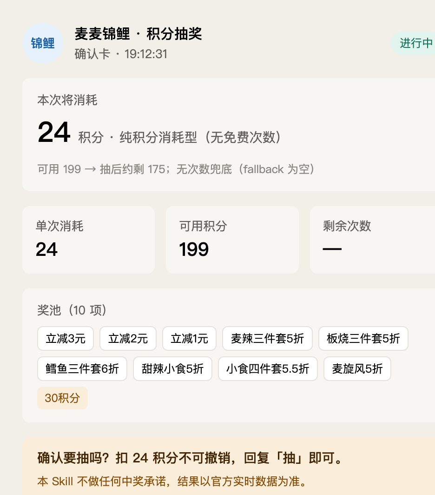
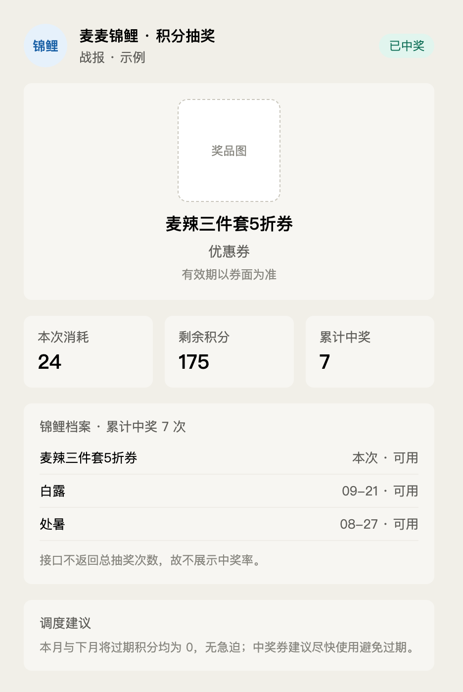
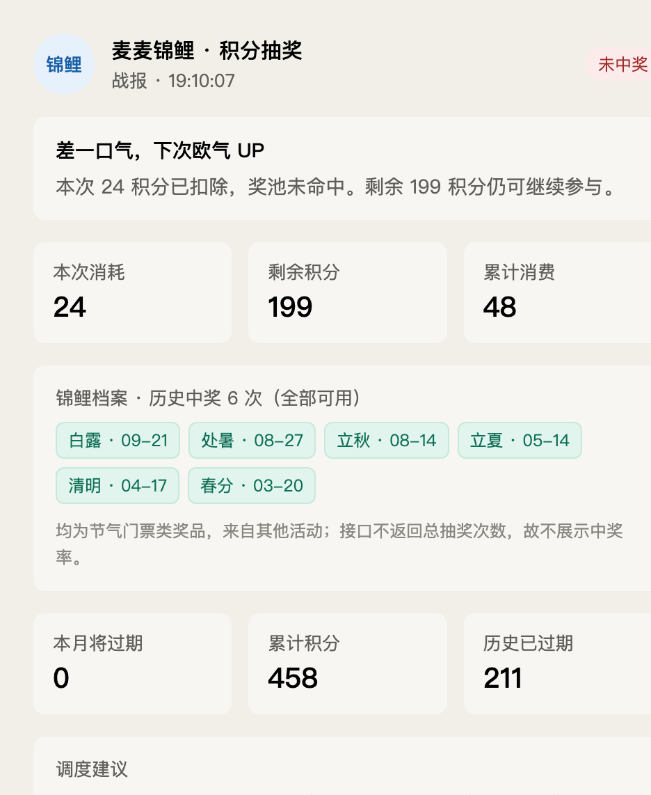
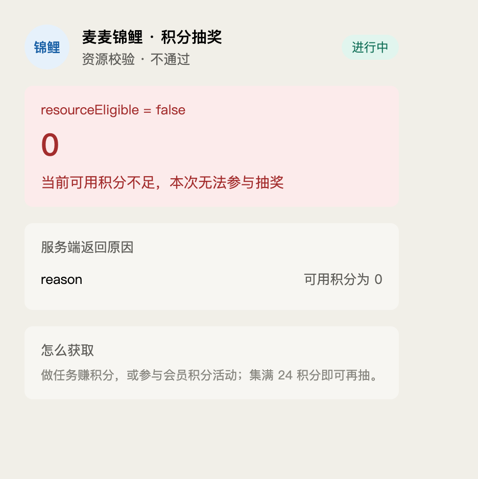
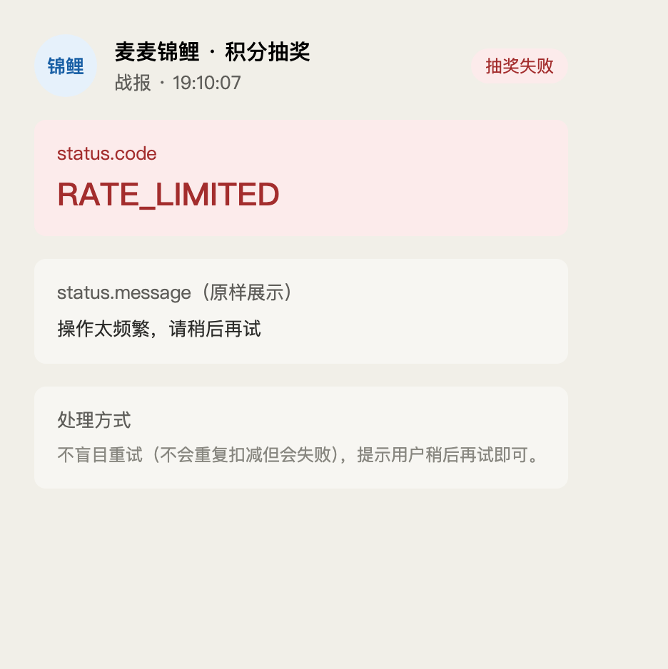

# 麦麦锦鲤 · 积分抽奖策略官 (mcd-lucky-koi)

## 项目介绍

麦麦锦鲤是一个基于麦当劳官方 MCP（`mcd-mcp`）「积分抽奖」子系统开发的 WorkBuddy Skill。它帮用户在麦当劳积分抽奖里**「守规则、有策略地薅」**：先把本次消耗讲清楚、等用户明确确认才抽、抽完沉淀「锦鲤档案」，并结合积分账户给出次数/积分的最优调度建议。

**为什么做这个：** 麦当劳 mcd-mcp 的「积分抽奖」子系统（`query-lottery-info` / `draw-lottery` / `query-my-prizes`）提供了完整且自带强约束的抽奖能力——必须「展示消耗 → 确认 → 才抽」。本 Skill 把这套约束固化成铁律，做出既合规又让人放心的抽奖体验，并额外叠加锦鲤档案、欧气值与积分调度建议。

## 目标用户

- 麦当劳会员 / 麦麦省积分用户，想薅积分抽奖但不想「瞎点」的人
- 关心积分与免费次数利用率、怕积分过期清零的精明消费者
- 喜欢轻量趣味交互（「今日锦鲤运势」「欧气榜」）的年轻用户

## 安装方法

### 方式一：作为 WorkBuddy 技能安装（推荐）

1. **配置 mcd-mcp 连接器**（见官方 README「WorkBuddy 开发指南」）：
   左侧边栏【专家 · 技能 · 连接器】→【连接器】→【自定义连接器】→【配置 MCP】，填入：

   ```json
   {
     "mcpServers": {
       "mcd-mcp": {
         "type": "streamablehttp",
         "url": "https://mcp.mcd.cn",
         "headers": {
           "Authorization": "Bearer YOUR_MCP_TOKEN"
         }
       }
     }
   }
   ```

   并将 `mcd-mcp` 启用（`YOUR_MCP_TOKEN` 替换为你的麦当劳 MCP Token）。

2. **安装本技能**：将本仓库 `skills/mcd-lucky-koi/` 目录放到 WorkBuddy 技能扫描目录：

   ```bash
   # 方式 A：直接复制
   cp -r skills/mcd-lucky-koi ~/.workbuddy/skills/mcd-lucky-koi

   # 方式 B：软链（便于跟随仓库更新）
   ln -sfn "$(pwd)/skills/mcd-lucky-koi" ~/.workbuddy/skills/mcd-lucky-koi
   ```

3. 刷新 / 重启 WorkBuddy，技能面板即可看到「麦麦锦鲤」。

### 方式二：直接对话触发

在已接入 `mcd-mcp` 的 WorkBuddy 会话中，直接说「抽奖 / 麦麦锦鲤 / 帮我抽一下」，AI 会按 Skill 流程引导。

## 使用示例

> 所有面向用户的产出统一渲染为 HTML 卡片（确认卡 / 战报卡 / 档案卡 / 调度卡）。

- 用户：「我现在能抽奖吗？」→ 拉取实时抽奖信息，渲染「确认卡」展示活动类型与本次消耗。
- 用户：「抽！」→ 校验 `resourceEligible`，确认后调用 `draw-lottery`，渲染「战报卡」展示中奖结果与更新后的剩余资源。
- 用户：「我中过什么？」→ 查询历史中奖，渲染「档案卡」（累计中奖、最值钱奖品、欧气值）。
- 用户：「积分快过期了怎么办？」→ 结合积分账户渲染「调度卡」（次数先用完、快过期积分先抽掉）。

## 卡片一览

Skill 在各步骤输出的卡片（截图取自本机真实运行结果）：

**Step 3 · 确认卡** — 展示活动、本次消耗，等用户明确确认后才抽



**Step 4/7 · 战报卡（中奖）** — 展示奖品、消耗与剩余、锦鲤档案与调度建议



**Step 4/7 · 战报卡（未中奖）** — 本机真实抽奖结果



**Step 2 · 资源不足卡** — `resourceEligible = false` 时说明差多少、怎么获取



**Step 4 · 失败卡** — 原样展示 `status.message`，不二次解读



## 合规与说明

- 本 Skill 严格遵守 `mcd-mcp` 抽奖接口的「展示消耗 → 确认 → 才抽」约束，禁止试抽 / 自动抽 / 连续抽。
- 输出统一使用宿主 CSS 变量渲染卡片，跟随当前主题，不硬编码配色。
- 详见 [CONTEST_DECLARATION.md](./CONTEST_DECLARATION.md) 与 [MCP_INTEGRATION.md](./MCP_INTEGRATION.md)。
- 项目输出仅供参考，餐品 / 积分 / 抽奖结果以麦当劳官方实时数据为准。
